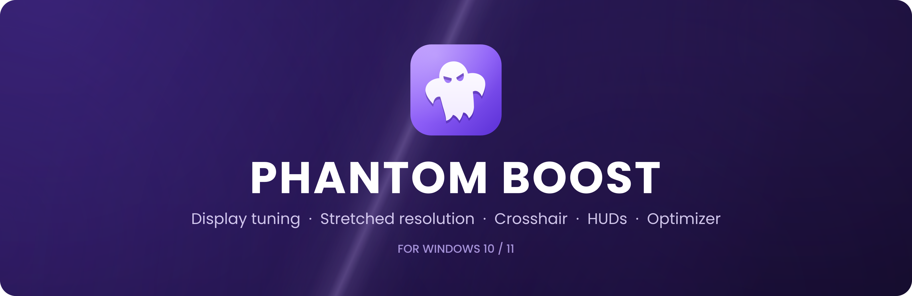
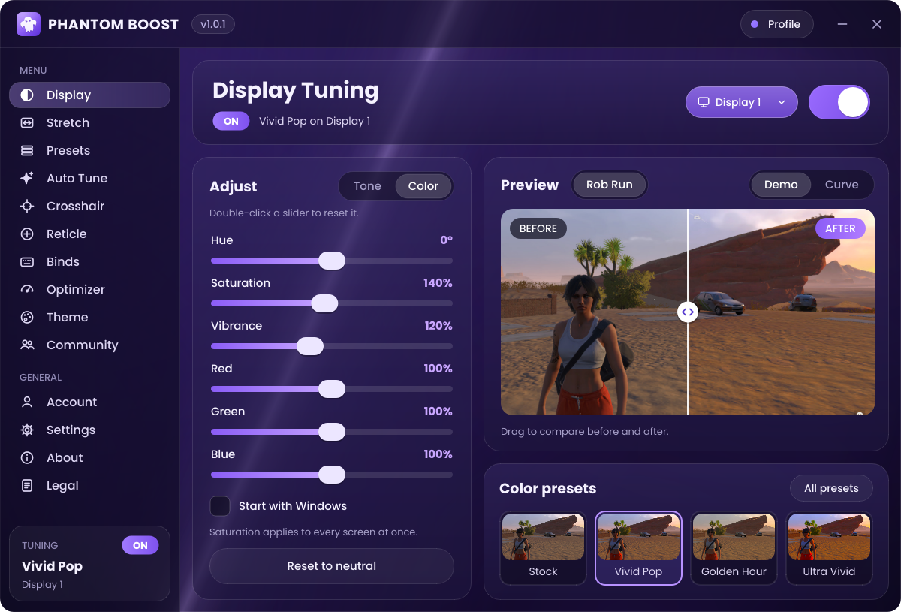
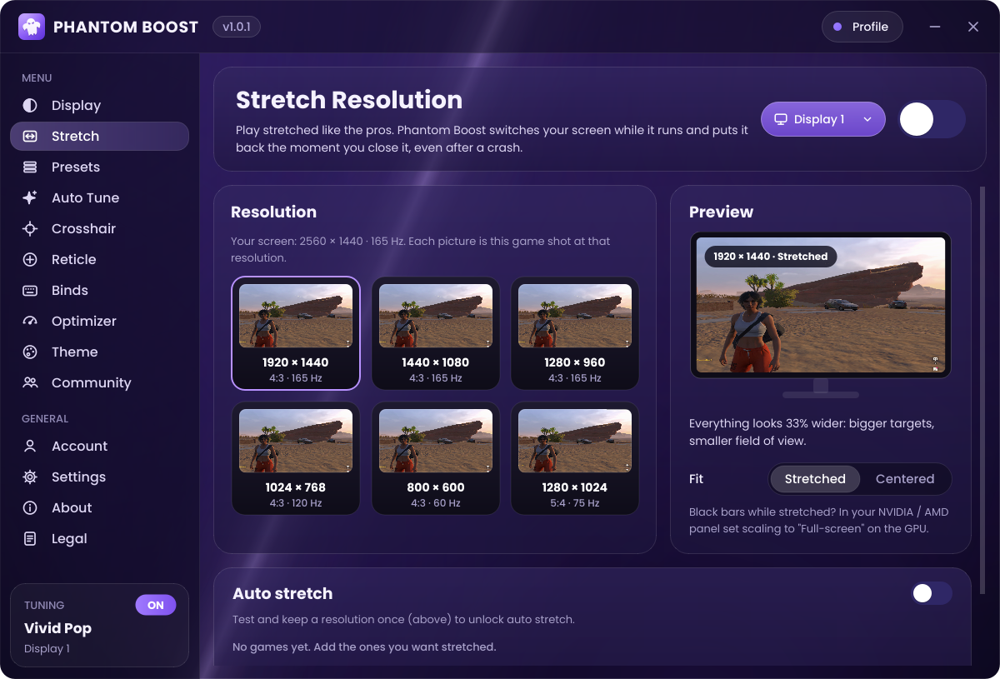
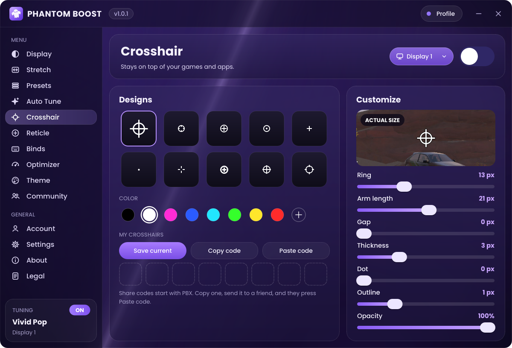
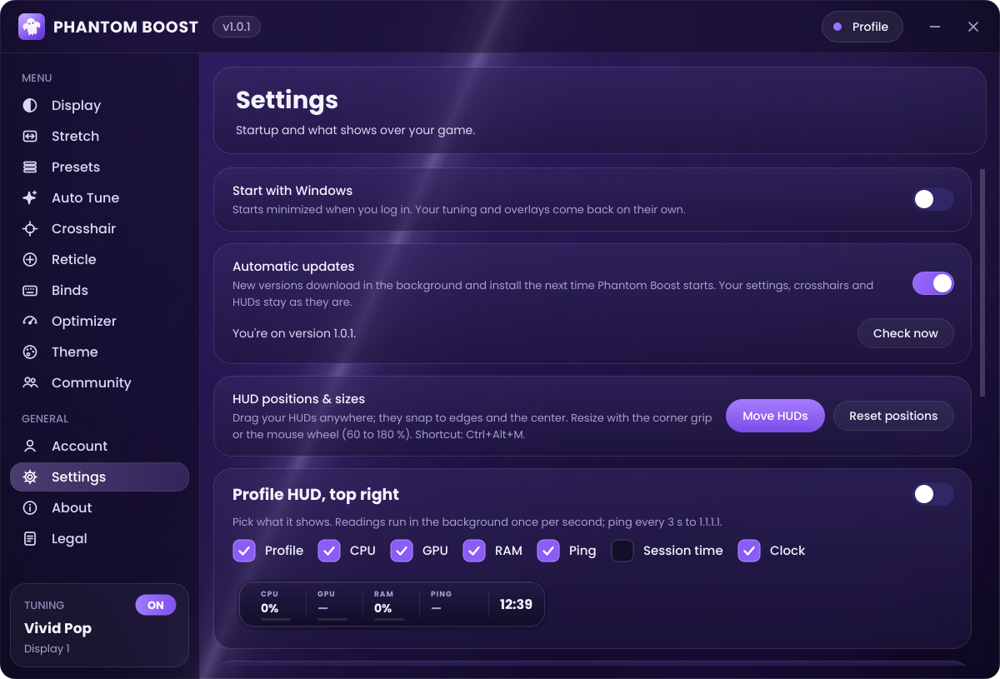

 

  

  

**Make your game look better, play stretched, and keep everything you need on screen.** 
One click to install. Updates install by themselves.

 

## ✨ Features

<table>
<tr>
<td width="50%" valign="top">

### 🎨 Display Tuning
Saturation, vibrance, hue, gamma and RGB per screen, with a live before / after preview and ready-made presets.

### 🖥️ Stretched Resolution
Play in 1440×1080, 1280×960… with a preview of each one. Auto stretch turns on by itself when your game is in front and goes back to normal when you alt-tab.

### 🎯 Crosshair & Reticle
10 designs, any color, size, gap, outline and opacity. Share your crosshair with a code.

</td>
<td width="50%" valign="top">

### 📊 HUDs
CPU, GPU, RAM, ping, FPS graph, keystrokes and an Apple Music card with synced lyrics. Drag and resize them anywhere.

### ⚡ Optimizer
Windows tweaks for games, with a full backup and one-click undo.

### 💜 Made to feel good
Smooth animations, custom backgrounds, Discord status, several screens supported and automatic updates.

</td>
</tr>
</table>

## 📸 Screenshots

## 📥 Install

1. **[Download PhantomBoost-Setup.exe](https://github.com/qqnr/phantom-boost/releases/latest/download/PhantomBoost-Setup.exe)** (always the latest version).
2. Open it. If Windows shows *"Windows protected your PC"*, click **More info** → **Run anyway**.
3. That's it: Phantom Boost installs in a few seconds, with a Start menu and desktop shortcut. No admin rights needed.

> 🔄 **Updates are automatic.** Phantom Boost downloads new versions in the background and installs them the next time it starts. Your settings stay as they are.

 

Made with 💜 by **wu** · [All versions](https://github.com/qqnr/phantom-boost/releases)

